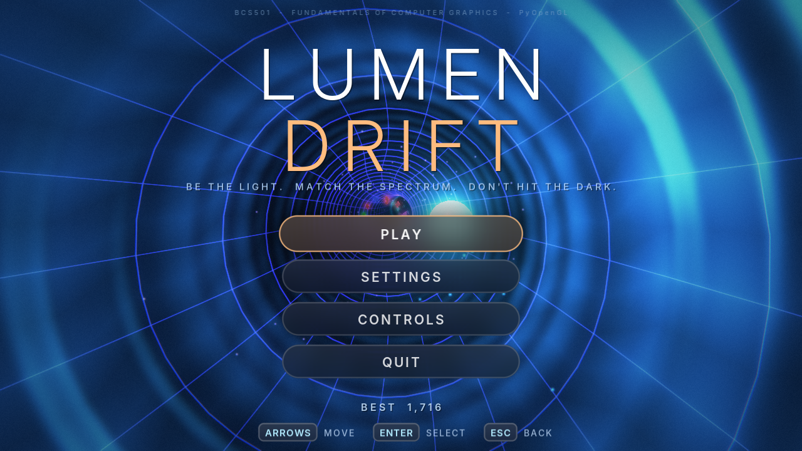
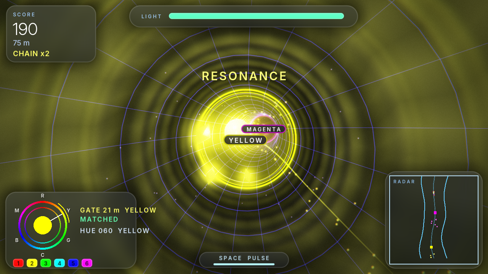
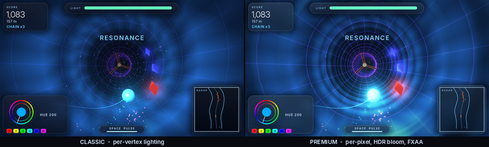
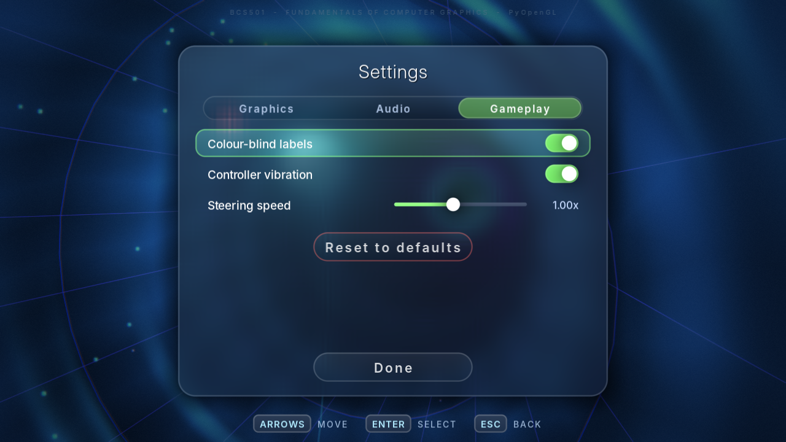
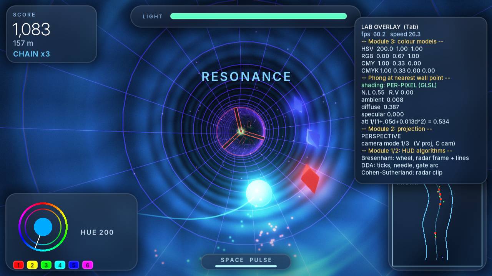
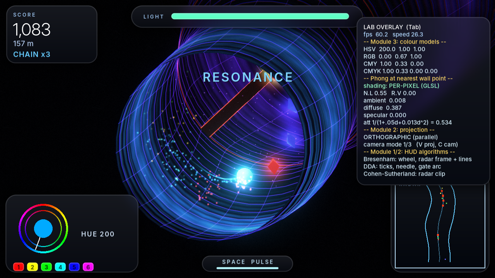

# LUMEN DRIFT

A 3D OpenGL tunnel-runner built for **BCS501 – Fundamentals of Computer Graphics** (PyOpenGL). It ships with two renderers:

- **Premium** (default): per-pixel Phong shading, HDR rendering with bloom, FXAA, film grain and speed effects, plus a frosted-glass UI.
- **Classic**: the pure fixed-function pipeline from the lab programs. Select it in *Settings → Graphics quality*, or run with `--classic`. If your GPU can't run Premium, the game falls back to Classic by itself.



## The idea

You are a point of light falling through an endless, bending tunnel. **You are also the only light source.**

- **Light is your health.** Everything you see is lit by *your* orb (a coloured Phong point light). Energy = light radius. As it drains, the world goes dark. Shards refill it.
- **Hue is your weapon.** Your orb has an HSV hue, and the light it casts repaints the whole tunnel in that colour. **Spectrum Gates** are colour filters: only an orb whose hue matches the gate (±24°) can pass. Any other colour shatters.
- **Red things hurt.** Pillars and spinning spoke-wheels are hazards. Dodge them, never match them.
- **Sonar pulse (Space)** floods the tunnel ahead with light for a moment, at an energy cost.
- The tunnel grid pulses to the generated music; everything you hear is synthesised from NumPy at start-up (no audio files).



## Run it

**Quickest** (creates a private environment on first run, then starts the game):

| OS | Do this |
|---|---|
| macOS | double-click `scripts/run_mac.command` (or `bash scripts/run_mac.command` in Terminal) |
| Windows | double-click `scripts/run_windows.bat` |
| Linux | `bash scripts/run_linux.sh` |

**Manually:**

```bash
python3 -m pip install -r requirements.txt
python3 lumen_drift.py          # Windows: py lumen_drift.py
```

Python 3.9+. Windows / macOS / Linux. It needs OpenGL 2.1+ with the legacy (compatibility) profile, which every desktop GPU/driver provides. No GLU needed. On macOS use `python3` (there is usually no `python`).

Useful flags: `--size 1600x900`, `--fps 60`, `--mute`, `--novsync`, `--seed N`, `--classic`, `--quality classic|balanced|premium|ultra`.

Problems? See [docs/TROUBLESHOOTING.md](docs/TROUBLESHOOTING.md).

## Premium features

| | |
|---|---|
| **Per-pixel Phong lighting** (GLSL 1.20) | The orb's point light, the far glow and the specular highlights are evaluated per pixel, with a ribbed normal-map on the tunnel panels. Classic is per-vertex (Gouraud). The Lab overlay (Tab) shows which one is active. |
| **HDR + bloom** | The scene renders into a 16-bit float framebuffer; a 4-level blurred bright-pass is added back, then a filmic tonemap rolls highlights off smoothly. |
| **FXAA** | Edge anti-aliasing in the composite pass (the framebuffer is not multisampled). |
| **Speed FX** | Chromatic aberration and radial blur that grow with speed and with impacts; film grain; vignette. *Settings → Motion effects* turns all of it (and screen shake and speed lines) off. |
| **Glass UI** | Anti-aliased rounded panels drawn as signed-distance fields, frosted by a blurred copy of the 3D scene behind them. Springs drive every hover, switch and slider. |
| **Quality presets** | Classic · Balanced (85 % render scale) · Premium · Ultra (150 % render scale, supersampled). |
| **Safe fallback** | No framebuffer support, a shader that won't compile, or RGBA16F unavailable (it drops to 8-bit) → the game quietly continues. |





## Settings

*Settings* is on the title screen and the pause menu. Everything is saved to `lumen_drift_settings.json` next to the game (validated and range-clamped on load; a corrupt or hand-edited file can never break the game).

- **Graphics**: quality, bloom, film grain, motion effects, field of view, fullscreen, FPS counter
- **Audio**: master, music, sound effects
- **Gameplay**: **colour-blind labels**, controller vibration, steering speed, reset to defaults

## Accessibility

- **Colour-blind labels** (*Settings → Gameplay*): every gate is named in the world (`YELLOW`, `MAGENTA`, …); the HUD names your hue and the target gate; the hue wheel is lettered R Y G C B M. Colour is never the only signal.
- Reduced-motion option (above).
- Whole game playable with keyboard only, mouse only for menus, or controller only.

## Controls

| Key | Action |
|---|---|
| **WASD / Arrows** | steer inside the tunnel |
| **Q / E** (hold), **mouse wheel** | rotate hue |
| **1 – 6** | snap hue to **R Y G C B M** (the six gate colours; later gates use 12 hues, use Q/E for those) |
| **Space** | sonar pulse (-8 energy, 3.5 s cooldown) |
| **V** | perspective ⇄ orthographic (parallel) projection |
| **C** | camera: chase / close / cockpit |
| **Tab** | **Lab overlay**: live HSV/RGB/CMY/CMYK values and Phong terms |
| **P / Esc** | pause · **M** music · **F11** fullscreen · **F12** screenshot |

**Gamepad** (Xbox, PlayStation, Switch Pro and most others, hot-pluggable): **left stick / D-pad** steer · **right stick or triggers** rotate hue · **LB / RB** snap hue ∓60° · **A** sonar pulse · **Start** pause · **B** back. In menus: stick or D-pad to move, **A** select, **B** back, **LB/RB** switch tabs. Vibration on impacts, gates and shards. Unplugging the pad pauses the game.

Menus: mouse (hover, click, drag sliders), arrow keys + Enter, or a controller. The title screen is a live **attract mode**: an autopilot flies the tunnel behind the menu.

HUD: score / distance / chain (top-left) · light bar (top-centre) · hue wheel + next-gate target (bottom-left) · radar (bottom-right).

---

## Syllabus → code map (for your viva)

Everything marked **gfxcore** is written from scratch in `gfxcore.py` (no OpenGL import, unit-tested). The game uses it for real work, not decoration.

| Module | Syllabus topic | Where it is |
|---|---|---|
| **1** | DDA line algorithm | `gfxcore.dda_line` → HUD bar ticks, hue-wheel needle, gate tolerance arc |
| 1 | Bresenham line (all slopes) | `gfxcore.bresenham_line` → every HUD frame, radar lines |
| 1 | Bresenham circle | `gfxcore.bresenham_circle` → the hue wheel (each pixel coloured by its angle) |
| 1 | Point / line attributes | `glPointSize`, `glLineWidth`, `GL_POINT_SMOOTH`, `GL_LINE_SMOOTH`, per-vertex colour |
| 1 | Coordinate reference frames | tunnel coords `(s, u, v)` → world (`world_pos`); logical 720-unit HUD frame with `glOrtho` |
| **2** | Homogeneous 2D transforms, composite, pivot rotation | `gfxcore.t2_*`, `compose`, `apply2` → radar maps world→screen with `T · S` |
| 2 | **Cohen–Sutherland clipping** | `gfxcore.cohen_sutherland` → radar walls are clipped to the radar window |
| 2 | 3D translate / rotate / scale, composite | `gfxcore.translate/rotate_*/rotate_axis/scale`; in-game `glTranslatef · glRotatef · glScalef` places every pillar and spoke |
| 2 | **Perspective & parallel projection** | `gfxcore.perspective`, `gfxcore.ortho` → loaded with `glLoadMatrixf`; press **V** to switch |
| 2 | Viewing (camera) | `gfxcore.look_at` (= `gluLookAt`) |
| 2 | Visible-surface detection | depth buffer (`GL_DEPTH_TEST`); transparent gates drawn last, sorted far→near with depth-writes off |
| **3** | RGB, CMY, CMYK, HSV | `gfxcore.rgb_to_cmy/cmyk`, `hsv_to_rgb`, … → gameplay hue; shown live in the Tab overlay |
| 3 | Light sources, ambient, diffuse, specular, **Phong model** | `gfxcore.phong_terms` (the maths, shown in the Tab overlay) · `glLightfv`, `glMaterialfv`, `GL_LIGHT0` at the orb, attenuation `GL_QUADRATIC_ATTENUATION` · **Premium:** the same model per pixel in `shaders.LIT_FS` |
| 3 | **Gouraud vs Phong shading** | Classic = per-vertex (Gouraud); Premium = per-pixel (Phong shading). Flip *Settings → Graphics quality* to see the difference on the specular highlights |
| 3 | Fog / atmospheric depth | `GL_FOG`, `GL_EXP2` |
| **4** | Input classification, interactive input, menus, GUI | event-driven (`KEYDOWN`, `MOUSEMOTION`, `MOUSEBUTTONDOWN`, controller buttons) + sampled (`get_pressed`, analogue sticks) input; hit-tested menus (hover/click/drag/keys/pad) in `ui.Menu`; `Game.handle` |
| **5** | Key-frame animation, motion specification | `gfxcore.Track` (linear / smoothstep / **Catmull-Rom**, loopable) → title camera fly-through, game-over pull-back |
| 5 | Periodic motion | rotating wheels `θ = θ₀ + ωt`, bobbing shards, `gfxcore.Pendulum`, beat-synced grid pulse |
| 5 | Animation procedures | double-buffered main loop, `dt`-based (frame-rate independent) update |
| 5 | Physically-based motion | `gfxcore.Spring` (damped harmonic oscillator) drives every UI animation |

Unit tests for every algorithm: `tests/test_gfxcore.py` (add `--gl` to also confirm our `perspective`/`ortho` matrices equal OpenGL's own `glFrustum`/`glOrtho`). Full table with function names: [docs/SYLLABUS_MAP.md](docs/SYLLABUS_MAP.md).




---

## Viva

Short spoken-style answers for every module (DDA vs Bresenham, homogeneous coordinates, Cohen-Sutherland, Gouraud vs Phong, key-frame animation, ...) and a 60-second demo script are in **[docs/VIVA_GUIDE.md](docs/VIVA_GUIDE.md)**.

> If this is graded work: confirm with your faculty that a game is acceptable for the mini-project, follow your institution's AI-assistance policy, and make sure you can explain `gfxcore.py` and the `Game` class yourself.

## Project layout

```
lumen_drift.py        the game (rendering, input, audio, HUD, level generation)
gfxcore.py            syllabus algorithms (pure Python + NumPy) + Spring + colour names
shaders.py            GLSL 1.20 sources: per-pixel Phong, glow, bloom, composite, glass panels
postfx.py             framebuffers, shader programs, bloom chain, rounded-rect drawer (+ automatic fallback)
ui.py                 menu model (keyboard / mouse / pad) and the glass widgets
gamepad.py            controller support (hot-plug, dead zones, rumble)
settings.py           validated, atomic, persistent settings
tests/                unit tests (gfxcore, settings, gamepad, ui) + end-to-end smoke test
scripts/              launchers (macOS / Windows / Linux) and the screenshot generator
docs/                 documentation set + screenshots
assets/fonts/         Inter (SIL Open Font License, see LICENSE-Inter.txt)
.github/              CI workflow, issue and pull-request templates
Makefile, pyproject.toml, requirements*.txt, LICENSE, CHANGELOG.md, CONTRIBUTING.md
```

Best score is saved next to the script in `lumen_drift_save.json`; settings in `lumen_drift_settings.json` (both git-ignored).

## Documentation

| Document | What's in it |
|---|---|
| [docs/ARCHITECTURE.md](docs/ARCHITECTURE.md) | modules, the tunnel maths, one frame, input model, failure handling |
| [docs/PREMIUM_RENDERER.md](docs/PREMIUM_RENDERER.md) | shader pipeline, quality presets, driver lessons, debugging |
| [docs/SYLLABUS_MAP.md](docs/SYLLABUS_MAP.md) | every BCS501 topic -> function -> where the game uses it |
| [docs/VIVA_GUIDE.md](docs/VIVA_GUIDE.md) | demo script and spoken answers |
| [docs/PROJECT_REPORT.md](docs/PROJECT_REPORT.md) | report skeleton ready to put your name on |
| [docs/TESTING.md](docs/TESTING.md) | how to test, what each test covers, verification gaps |
| [docs/TROUBLESHOOTING.md](docs/TROUBLESHOOTING.md) | common errors and fixes |
| [docs/ROADMAP.md](docs/ROADMAP.md) | what could come next |
| [CHANGELOG.md](CHANGELOG.md) · [CONTRIBUTING.md](CONTRIBUTING.md) | history and how to contribute |

## Testing

```bash
make test       # 34 unit tests, no GPU needed
make smoke      # end-to-end test through every screen (needs OpenGL; headless Linux: xvfb-run -a)
make shots      # regenerate docs/ screenshots
```

Everything was built and verified headless under software OpenGL (Mesa llvmpipe): all screens, every key and gamepad action, Premium <-> Classic switching at run time, the fallback path, crash / game-over / restart, and the autopilot flying 500+ metres.

**Not yet run on real GPU hardware, a real controller, or by a human with ears.** The first things to tune are game balance (`base_speed`, `spawn_piece`, `HUE_TOL`), the bloom/exposure look on your display (*Settings -> Bloom*), and the music mix. macOS only supports OpenGL 2.1 in a legacy context, which is what this targets; if Premium misbehaves on your machine, the console prints `[premium renderer unavailable - using Classic]` and why, or just pick Classic.

## License

MIT, see [LICENSE](LICENSE). The bundled Inter fonts are under the SIL Open Font License 1.1 (`assets/fonts/LICENSE-Inter.txt`).
